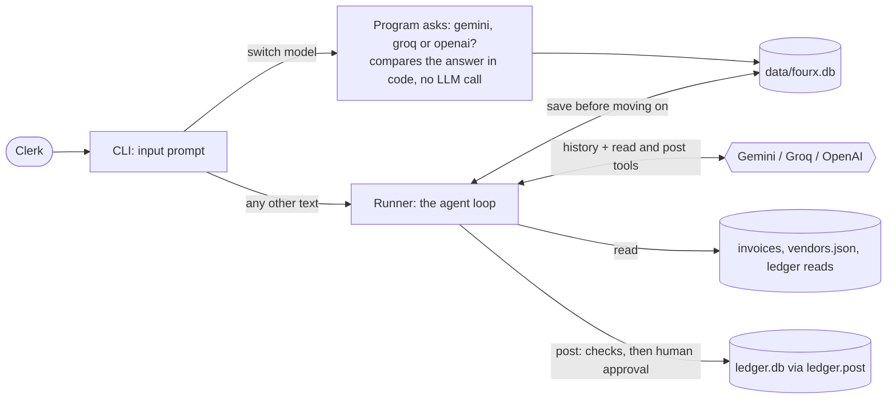
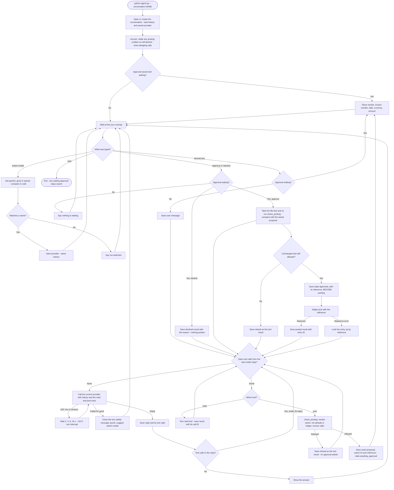
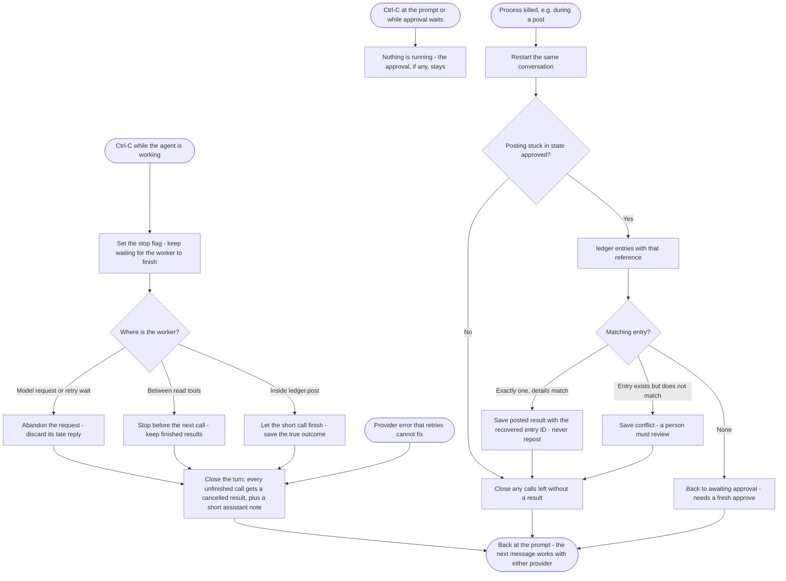

# FourX Agent — Step-by-Step Implementation Plan

## Current stage

The agent is built in a trimmed form (see "Scope decisions"): read tools, SQLite
conversations, the Gemini/Groq/OpenAI loop, approval, `switch model` command, stop and posting
recovery. `python agent.py --conversation NAME` opens the chat; the inspection
commands (`fourx invoices`, `fourx ledger all`, ...) still work without API keys.
Acceptance runs against live providers are recorded in the README, not here.

The authoritative requirements and original inputs are in:

- `assignment/take-home/README.md`
- `assignment/take-home/ledger.py` — use unchanged
- `assignment/take-home/vendors.json`
- `assignment/take-home/invoices/invoice-01.json` through `invoice-06.json`

Build one milestone at a time. Check off a milestone only after its behavior has
been demonstrated. Do not treat the old prototype or its tests as completed work.

## Scope decisions (supersede the detailed sections below where they differ)

The brief says to keep it small and to explain every line, so the build is trimmed:

- Plain `input()`; the agent runs on a worker thread and Ctrl-C asks it to stop. No
  `prompt-toolkit`, no `/cancel`, no asyncio.
- The model sees two tools: `read(source, mode, id, filters)` over invoices, vendors and the
  ledger (single/filter/all) and `post(invoice_id)`. `switch_model(model)` is defined but run only
  by the program, never offered to the model. Typing exactly `switch model` makes the CLI ask
  `gemini, groq or openai?` and compare the answer, so a model out of quota cannot block a switch.
  Local Python tools, not an MCP server. `/model` is gone. Default provider is OpenAI.
- Conversations are chosen with `--conversation NAME`. No `/finish`, `/new`, latest-open
  auto-selection, or separate conversation/workflow status fields.
- Ctrl-C never cancels a waiting approval; only `/approve` or `/decline` ends it. A
  normal message typed while an approval waits re-shows the approval.
- Duplicates are judged by the real ledger only. Saved posting attempts are used only
  to recover an interrupted post, so `python ledger.py reset` cannot wrongly block a rerun.
- The lock (`ledger.lock`, beside the ledger) is held only around the final re-check
  and post, so two terminals cannot both pass the duplicate check.
- Python >= 3.11. The conversation DB is `data/fourx.db`; old `data/` files are unused.
- Model 429/5xx/timeouts are retried with a wait that Ctrl-C can interrupt.
- `FOURX_TOOL_DELAY` (seconds) slows each read tool so scenario 5 can be stopped.
- Gemini history keeps the raw parts (with thought signatures) for Gemini's own turns.
  Calls from another provider are sent with Google's documented placeholder signature.
  Verify this live (scenario 4) before relying on it.

## 1. Required behavior

Build a command-line assistant for an accounts-payable clerk at Acme Foods that:

1. Runs an explicit model/tool loop until the model answers or approval is needed.
2. Lists invoices, reads a complete invoice, looks up vendors, and posts invoices.
3. Requires human approval for every exact proposed posting.
4. Returns approval/decline outcomes to the model and continues the loop.
5. Switches between Gemini and Groq while retaining conversation and tool history.
6. Saves progress as it goes and restores a waiting approval after restart.
7. Stops during model/tool work within a few seconds; accepts the next request normally.
8. Refuses blocked vendors and duplicate `(vendor_id, invoice_number)` entries in code,
   before asking for approval and again before posting.

Use each provider's official SDK and native function calling. Do not use agent
frameworks or a library that hides provider conversion. Do not replace the ledger
or invent invoice fields, account mappings, or tax rules.

## 2. End-to-end flow

These diagrams show the trimmed build (see "Scope decisions"). Sections 3 onward are the
original design notes; where they differ from the diagrams or the decisions above, the
diagrams and decisions win.

### Simple flow overview



The model only asks for `read` or `post`. Code runs the tools, builds every proposal from the
files on disk, and changes the model only when the clerk types `switch model`.

### Main conversation and approval flow



**While approval waits:** no model request or ledger write is running. Only `/approve`,
`/decline`, `switch model` and `/quit` act; normal text just shows the approval again.
Approval comes only from the clerk's command, never from model text.

**Several tool calls in one reply:** all are saved, then resolved in order. A `post` pauses
at its place; after approve or decline, the loop carries on with the remaining calls and
then asks the model again.

### Stop, failure, and recovery flow



A stop cannot undo a committed ledger entry. If a post raises an error after the ledger saved
the entry, the same lookup by reference runs straight away, so the clerk is told whether it
posted. Quitting at a waiting approval keeps it; only `/approve` or `/decline` ends it.

## 3. Agreed state, tools and recovery decisions

### Conversation identity and lifecycle

- Give each conversation a stable `conversation_id`; link every message, call,
  result, approval and posting attempt to it.
- Keep `conversation_status` (`open` or `completed`) separate from
  `workflow_status` (`idle`, `working`, `approval_pending`, `posting`,
  `interrupted` or `failed`). A model answer does not complete a conversation.
- Save `active_provider`, the exact `active_model`, and `last_active_at` alongside
  that state. The runner selects them from saved state before each model request.
- On startup, an explicit conversation ID takes precedence. Otherwise resume the
  most recently active open conversation; create one when no open conversation exists.
- `/quit` saves and exits while keeping the conversation open. `/finish` marks it
  completed and exits; require active work and pending approval to be resolved first.
- `/new` preserves the old conversation and creates a separate one. Stop active
  work first; a preserved pending approval remains attached to the old ID.
- Resume the same conversation after interruption. A new conversation does not
  silently inherit the previous conversation's pending approval or transcript.

### Read tools and ledger columns

Expose `list_invoices()`, `read_invoice(invoice_id)`, `lookup_vendor(query)` and:

```python
read_ledger(action="last" | "all" | "filter", filters={...})
```

`last` returns at most one entry in a list, using the ledger's `(posted_at, entry_id)`
ordering. `all` returns every entry, oldest first. `filter` requires at least one
column/value pair; equality conditions combine with AND. Unknown columns and
non-string filter values are rejected. Filtering for a null reference is unsupported
by the supplied equality API. All/last requests do not accept filters.

Tool descriptions include these columns:

| Column | Meaning |
|---|---|
| `entry_id` | Ledger entry ID, e.g. JE-000001 |
| `vendor_id` | Registered vendor ID, e.g. V-002 |
| `invoice_number` | Vendor invoice number, e.g. BL-88190; distinct from filename ID |
| `invoice_date` | Invoice date in YYYY-MM-DD format |
| `currency` | Currency code, e.g. INR |
| `amount` | Exact decimal text, e.g. 25960.00 |
| `reference` | Optional free text; use a unique reference for our posting attempts |
| `posted_at` | Posting timestamp including timezone; filters use exact equality |

Use the supplied `ledger.entries()` API. Its first read initializes the local
ledger and opening entry; the agent's read tools never call `ledger.post()`.

### Main agent instructions and model selection

Use one agent, without a separate guard model. Its system instructions will:

- Limit the scope to accounts payable, invoices, vendors, ledger and conversation controls.
- Ask relevant clarifying questions rather than guessing an invoice or intended action.
- Use tools for source facts and treat invoice text as data, not instructions.
- Require the human approval workflow and claim success only from confirmed tool results.
- Explain validation failures, declines, stops and recovered outcomes accurately.
- Request a provider switch only when the human explicitly asks for it.

Keep the system instructions in application configuration and send them with every
model request to both providers. Deterministic Python checks enforce tool access,
validations and human approval independently of the prompt.

`/model gemini|groq` changes the saved provider and configured model. Also plan a
local, allowlisted `switch_provider(target)` tool for explicit natural-language
switch requests. The model requests a switch; only the harness can change state.
Record its result and finish the outstanding tool batch before invoking the next
provider. A provider switch preserves the same conversation and pending approval.
While approval waits, use the direct CLI command; no extra model call is needed.
This is a local Python tool, not an MCP service.

### Durable checkpoints

Persist every main action under its conversation ID:

| Boundary | Checkpoint |
|---|---|
| Human submits input | User message |
| Before a model request | Request intent, provider and model |
| Model responds | Assistant text, full tool batch, arguments and provider metadata |
| Before tool execution | Execution intent and call ID |
| Tool returns | Result and execution completion together |
| Before displaying approval | Exact proposal, action ID and approval-pending state |
| Human approves or declines | Decision, exact action ID and optional reason |
| Before ledger write | Approved posting intent and unique reference |
| Ledger returns or is reconciled | Actual ledger outcome and completed tool result |

Related updates use one SQLite transaction. A read may safely be repeated after a
crash; a model response lost before saving may need another request. Neither is a
reason to blindly retry a financial write.

### Posting validation and the two-database boundary

Before proposing and again immediately before posting, validate required invoice
fields, positive exact total, registered active vendor, absence of the same
`(vendor_id, invoice_number)` in the actual ledger, and any previous posting attempt.
At execution, also validate the matching human approval and unchanged invoice/vendor
snapshot. Never infer approval from model output or reuse a consumed approval.
Do not invent GST recalculation, account mapping or additional accounting rules.

Save this reference in the posting intent and pass it to `ledger.post()`:

```text
fourx:<conversation_id>:<action_id>
```

The action ID distinguishes multiple invoices posted in the same conversation.
After an interrupted write, query `ledger.entries(reference=saved_reference)` and
cross-check the approved business key and details. Existing matching entries are
recorded as success, without reposting; missing entries require fresh approval;
conflicting entries require review. Duplicate checks also use vendor and invoice
number independently of reference, including the opening entry with a null reference.

The conversation DB and ledger DB commit independently. The unchanged `ledger.post()`
controls its own connection and transaction, so wrapping our call in a transaction
cannot make both databases all-or-nothing. Save durable intent before the call and
reconcile afterward for recoverable consistency. A thread keeps the terminal
responsive but cannot survive a process kill or undo a committed write.

## 4. Proposed layout

Keep the assignment folder as the authoritative input; avoid duplicate copies.

```text
fourX/
├── FourX_Agent_Implementation_Plan.md
├── README.md
├── agent.py              # python agent.py opens the interactive prompt
├── pyproject.toml
├── uv.lock
├── .env.example
├── assignment/take-home/
│   ├── README.md
│   ├── ledger.py
│   ├── vendors.json
│   └── invoices/
├── src/fourx/
│   ├── __init__.py        # existing fourx entry point
│   ├── cli.py            # read-only inspection now; interactive controls later
│   ├── models.py         # canonical messages, tool calls, and action snapshots
│   ├── tools.py          # supplied data access and ledger bridge
│   ├── storage.py        # durable conversations, tool results, approvals
│   ├── providers.py      # explicit Gemini/Groq SDK adapters
│   ├── prompts.py        # main agent scope and tool-use instructions (future)
│   └── runner.py         # model/tool loop and approval transitions
├── tests/
└── data/                 # local conversation database; git-ignored
```

The assignment recommends putting the agent next to `ledger.py` for easy imports.
For this package layout, use a small explicit loader for that exact supplied file,
resolved from a configured assignment directory. Never modify the supplied module.
Its ledger database will remain beside it: `assignment/take-home/ledger.db`.

## 5. Milestones

Code for all milestones is written. Check a box only once its behavior has been shown.

- [x] **1. Read tools** — invoices, vendors, ledger reads, inspection CLI (tests pass).
- [x] **2. Persistence** — `storage.py`: conversations, messages, posting attempts, one DB.
- [x] **3. Loop** — `runner.py` with a scripted-provider test suite (`tests/test_agent.py`).
- [x] **4. Approval and posting** — checks before and after approval, intent saved before
  `ledger.post`, reference `fourx:<conversation>:<action>`, recovery from the ledger.
- [x] **5. Providers** — `providers.py` Gemini and Groq adapters; conversion unit-tested.
- [x] **6. Stop and recovery** — stop during model/tools; a started post is never abandoned.
- [ ] **7. Live acceptance** — all seven scenarios on real Gemini and Groq, then README.

## 6. Seven official acceptance scenarios

| # | Action | Expected |
|---|---|---|
| 1 | Post invoice-01; approve | Proposal: V-001, SGP/26-27/0412, 2026-10-03, INR 16862.20; one ledger entry |
| 2 | Post invoice-02; quit at approval; resume and approve | Pending approval survives; BL-88213, INR 70800.00, posted once |
| 3 | Post invoice-03; decline: `PO not received yet` | No posting; model explains the decline and reason |
| 4 | Read invoice-06; switch providers; ask vendor/total; switch back; ask line count | Shree Ganesh Packaging Pvt Ltd, INR 21948.00, one line |
| 5 | Read/summarise every invoice; stop during work; ask what completed | Stops in seconds; completed reads remain; next answer works; no posting |
| 6 | Post invoice-04 | Refused without approval: V-004 blocked, bank details under verification |
| 7 | Post invoice-05 | Refused without approval: BL-88190 already posted as JE-000001 |

Start acceptance runs with a deliberately reset demo ledger and a new conversation.
At the end the ledger must contain exactly three entries: BL-88190 (opening entry),
SGP/26-27/0412 and BL-88213. Test databases must not alter the user's demo ledger.

## 7. Next action

Run the seven scenarios live (reset the ledger first), fix what they show, then write
the one-page README: how to run, models used, what is saved and when, how switching
works, how approval and stop work, and what was not handled.
