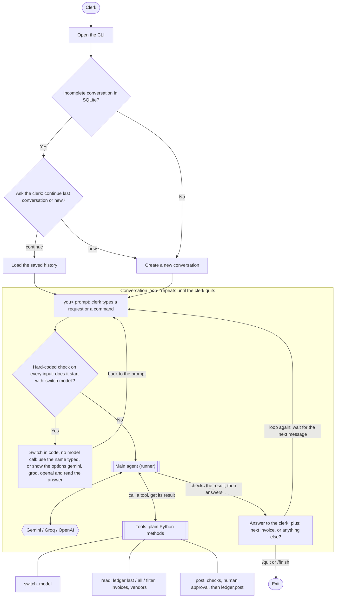
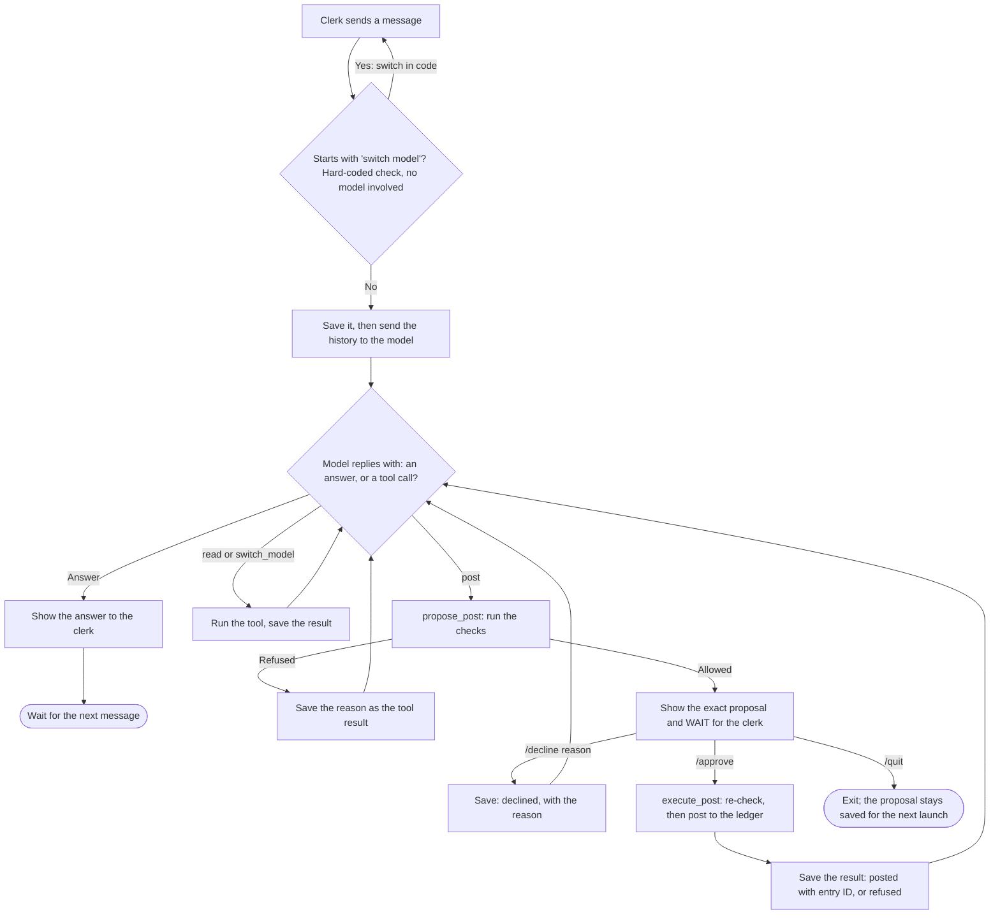
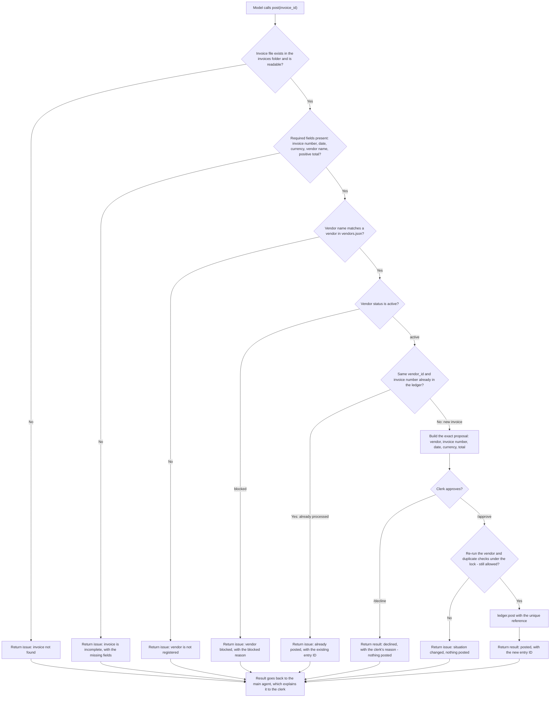
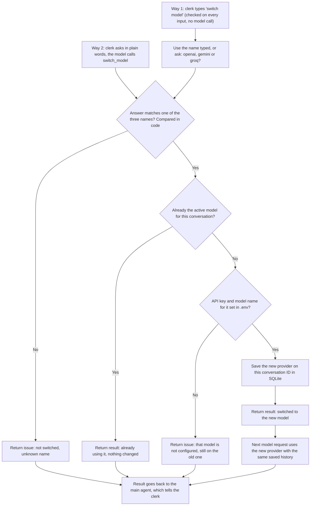
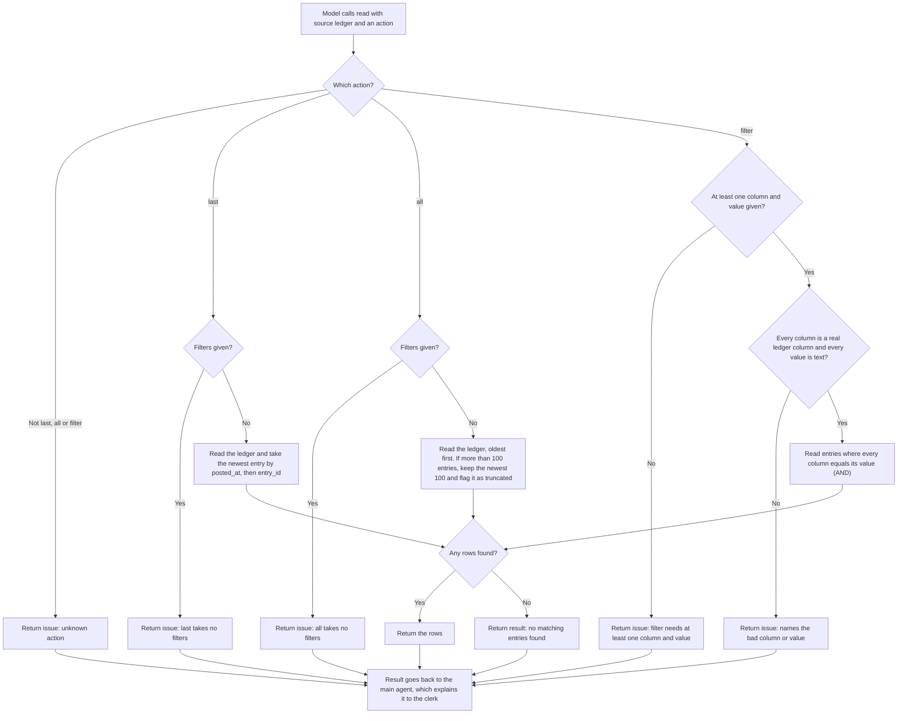

# FourX Agent — Implementation Plan

## Current stage

The agent is built and its automated tests pass. What is still open is the live acceptance run
on real OpenAI, Gemini and Groq models (milestone 8, section 4); it needs API keys in `.env`.
`python agent.py` opens the chat. The how-to-run notes are in `README.md`.

The authoritative requirements are in `assignment/take-home/README.md`. The supplied
`ledger.py`, `vendors.json` and `invoices/` now live in `src/fourx/`; `ledger.py` is used
unchanged, and its database is `src/fourx/ledger.db`.

## Scope decisions

The brief says to keep it small and to explain every line, so the build is trimmed:

- **Plain code.** Plain `input()`, no framework, no async, no MCP server. The tools are plain
  Python methods in `src/fourx/agent_tools.py` that the loop calls directly.
- **One visible loop.** `Agent.run()` in `runner.py`: ask the model; if it answers, show the
  answer; if it asks for tools, run them, save the results, and ask again.
- **The agent has three jobs:**
  1. **Switch model**, in two ways. (a) Typed: the CLI checks every input, and a line starting
     with `switch model` switches in code with no model call (`switch model groq`, or
     `switch model` and then `gemini, groq or openai?`). It still works when the current model
     is out of quota. (b) By the model: `switch_model` is also a tool, so "please use gemini"
     works. The prompt tells the model to switch only when the clerk explicitly asks.
  2. **Read data** with `read`. Ledger: `last`, `all` (newest 100, flagged `truncated`) or
     `filter` (exact equality on any column, AND). Also invoices and vendors by ID or name.
  3. **Post an invoice** with `post`: code checks, then human approval, then the ledger.
- **Posting is split in two methods** so approval can sit between them: `propose_post` runs
  the checks and builds the exact proposal; `execute_post` re-checks under a file lock and
  calls `ledger.post`. The model's `post` becomes `propose_post`. The runner calls
  `execute_post` itself, only after the clerk types `/approve`. The model can never approve.
- **Conversations.** Each has one status, `open` or `completed`. On launch, if SQLite holds an
  open conversation, the CLI asks `continue` or `new` (compared in code, no model call);
  otherwise it starts a new one. `continue` reloads the saved history; if the conversation
  stopped mid-turn, the agent carries on from it. `new` leaves the old one open. `/quit` keeps
  a conversation open; `/finish` completes it. No `--conversation` flag, no `/new`.
- **Approval is inline.** When a post is proposed, the loop shows the exact vendor, invoice
  number, date and amount and waits at an `approval>` prompt for `/approve`,
  `/decline <reason>` or `/quit`. Ctrl-C does not cancel it. Typing anything else shows the
  proposal again. `/quit` leaves the post call without a result, so the next launch asks again.
- **Follow-up question.** The system prompt has the agent end each finished task by asking
  whether to work on the next invoice or help with anything else.
- **Duplicates** are judged by the real ledger only (same vendor and invoice number), so
  `python ledger.py reset` cannot wrongly block a rerun.
- **Stop.** Ctrl-C raises `KeyboardInterrupt` in the main thread. The turn is closed:
  every unfinished tool call gets a "cancelled" result, so either model accepts the next
  message. A post that has started is not interrupted (Ctrl-C is ignored until it returns).
- **Retries.** A model 429, 5xx or timeout is retried with waits of 2, 4, 8 and 16 seconds.
- **Gemini** keeps its raw parts (with thought signatures) for its own turns. Calls made by
  another provider are sent to Gemini with Google's documented placeholder signature.
- Python >= 3.11. The conversation database is `data/conversations.db`. An older-layout file
  is renamed `.old` on first start.

## 1. Required behavior

A command-line assistant for an accounts-payable clerk at Acme Foods that:

1. Runs an explicit model/tool loop until the model answers.
2. Reads invoices, vendors and the ledger, and posts invoices.
3. Requires human approval for every exact proposed posting.
4. Returns approval, decline and refusal outcomes to the model and continues the loop.
5. Switches between OpenAI, Gemini and Groq while keeping conversation and tool history.
6. Saves progress as it goes and restores a waiting approval after a restart.
7. Stops during model or tool work within a few seconds, then accepts the next request.
8. Refuses blocked vendors and duplicate `(vendor_id, invoice_number)` entries in code, before
   asking for approval and again before posting.

Use each provider's official SDK and native function calling. No agent frameworks, and no
library that hides provider conversion. Do not replace the ledger or invent invoice fields,
account mappings or tax rules.

## 2. End-to-end flow

One diagram: how the CLI reaches the main agent, and how the main agent reaches its three
tools. The sections after the diagrams give the rules behind them.



The first thing that happens to every input is a hard-coded check in the CLI, before any model
is called: if the line starts with `switch model`, the CLI switches the model itself, so a model
that is out of tokens or quota can never block a switch. Everything else goes to the main agent.

The conversation is a loop. After every outcome, whether an invoice was posted, declined or
refused, or a question was answered, the main agent comes back to the clerk with a short
follow-up such as "Shall we work on the next invoice, or is there anything else I can help
with?" The clerk's next message starts the next pass through the same loop, in the same
conversation, until `/quit` or `/finish`.

### Conversation and approval flow (simple)

One turn, start to finish. The model never approves anything; only the clerk does.



In words: the model keeps asking for tools until it has enough to answer. Every tool result,
including a refusal or a decline, goes back to the model, which then explains it to the clerk.
Only `post` stops and waits. While it waits, other typed text just shows the proposal again.

### Post tool flow

The `post(invoice_id)` tool checks in a fixed order and stops at the first problem. Every
refusal goes back to the model as the tool result, with the reason, so the model can explain
it to the clerk. The checks are code, not model judgement.



Notes:

- The invoice carries a vendor name, not an ID, so the vendor is found by exact name in
  `vendors.json`; the ledger duplicate check then uses that vendor's `vendor_id`.
- Nothing is written to the ledger unless every check passes and the clerk has approved. The
  approval step is kept even though the checks alone could post, because the brief requires a
  human to approve every exact posting.
- The approval comes only from the clerk's `/approve` or `/decline`, never from model text.
- In `agent_tools.py` this is the `propose_post` tool (steps up to the proposal) and the
  `execute_post` tool (the re-check and `ledger.post`). The runner handles the approval in between.

### Switch model flow

The `switch_model(model)` tool changes which LLM (OpenAI, Gemini or Groq) answers in the
current conversation. The conversation ID, the saved history and any waiting approval stay
the same; only the provider saved on that conversation changes.



Notes:

- Switching is a saved-state change only; it makes no model request, so it works even when the
  current model is out of quota, and while an approval is waiting.
- The switch is per conversation. Another conversation keeps its own saved provider.
- Switching is allowed only when the clerk asks. The prompt tells the model never to switch on
  its own. When the current model is out of quota, only way 1 works.
- History is stored in our own format, so the new provider reads the earlier messages and tool
  results as if it had written them.

### Read ledger flow

The `read` tool looks at the ledger without ever writing to it. For the ledger it has three
actions: `last`, `all` and `filter`. It returns the rows it finds, or a clear "no entries
found" result, so the model can tell the clerk. Bad requests return the issue instead.



Notes:

- Columns: `entry_id`, `vendor_id`, `invoice_number`, `invoice_date`, `currency`, `amount`,
  `reference`, `posted_at` (see "Ledger columns" below).
- Filters use exact equality, so `amount` is matched as text such as `25960.00`, and
  `posted_at` must match the full timestamp.
- "No entries found" is a normal answer, not an error. For `last` and `all` it means the
  ledger is empty; for `filter` it means nothing matched.
- The tool only reads through `ledger.entries()`. It never calls `ledger.post()`.

## 3. Reference

### Ledger columns

| Column | Meaning |
|---|---|
| `entry_id` | Ledger entry ID, e.g. JE-000001 |
| `vendor_id` | Registered vendor ID, e.g. V-002 |
| `invoice_number` | Vendor invoice number, e.g. BL-88190; distinct from the filename ID |
| `invoice_date` | Invoice date, YYYY-MM-DD |
| `currency` | Currency code, e.g. INR |
| `amount` | Exact decimal text, e.g. 25960.00 |
| `reference` | Free text; our posts use `fourx:<conversation_id>:<call_id>` |
| `posted_at` | Posting timestamp including timezone; filters use exact equality |

Ledger reads use the supplied `ledger.entries()`. The read tool never calls `ledger.post()`.

### What is saved, and when

Two tables in `data/conversations.db`: `conversations` (id, provider, status, created and last
active time) and `messages` (the user text, each model reply with its tool calls, each tool
result). Every message is saved the moment it exists. The saved history is all a restart needs:

| Situation | What happens on the next launch |
|---|---|
| Quit at a waiting approval | The post call has no result, so approval is asked again. |
| Killed during a post | The call is still open; the check runs again and the ledger's duplicate rule refuses a second post. |
| Stopped with Ctrl-C | Open calls were closed as "cancelled"; the next message works. |
| Model error that retries cannot fix | The turn is closed with a note; the clerk's message is saved. |

The conversation database and the ledger commit separately, so the ledger cannot be part of
one transaction with SQLite. The duplicate rule is what makes a repeat after a crash safe.

### Switching models

History is stored in one neutral format (role, text, tool calls, tool results), not either
SDK's. Each adapter in `providers.py` converts it on every request, so a switch only changes
which adapter reads the same history. `llms.get_llm(name)` returns the adapter for `openai`,
`gemini` or `groq`; it needs `<NAME>_API_KEY` and `<NAME>_MODEL` in `.env`.

### Files

```text
agent.py                 entry point: python agent.py
src/fourx/
  cli.py                 the prompt, continue-or-new question, commands
  runner.py              the agent loop, approval, stop
  agent_tools.py         the tools: read, propose_post, execute_post, switch_model
  tools.py               invoice, vendor and ledger logic behind the tools
  llms.py, providers.py  get_llm(name) and the OpenAI / Gemini / Groq adapters
  storage.py             SQLite conversations
  prompts.py             the system prompt
  models.py              shared types
  ledger.py, vendors.json, invoices/   supplied data (ledger.py unchanged)
tests/                   scripted-model tests; no API key needed
```

## 4. Milestones

- [x] **1. Read tools** — invoices, vendors and ledger reads.
- [x] **2. Providers** — OpenAI, Gemini and Groq adapters, `get_llm(name)`.
- [x] **3. Storage** — conversations with `open` / `completed`, messages, continue-or-new.
- [x] **4. The loop** — `Agent.run()` with a scripted-model test suite.
- [x] **5. Approval and posting** — checks, inline approval, duplicate and blocked-vendor refusal.
- [x] **6. Switching** — typed `switch model`, and the `switch_model` tool.
- [x] **7. Stop and resume** — Ctrl-C closes the turn; a waiting approval survives a restart.
- [ ] **8. Live acceptance** — all seven scenarios on real models, then fill in the README.

Checked boxes mean the automated tests pass, not that the behavior has been shown on live models.

## 5. Seven official acceptance scenarios

| # | Action | Expected |
|---|---|---|
| 1 | Post invoice-01; approve | Proposal: V-001, SGP/26-27/0412, 2026-10-03, INR 16862.20; one ledger entry |
| 2 | Post invoice-02; quit at approval; resume and approve | Pending approval survives; BL-88213, INR 70800.00, posted once |
| 3 | Post invoice-03; decline: `PO not received yet` | No posting; model explains the decline and reason |
| 4 | Read invoice-06; switch providers; ask vendor/total; switch back; ask line count | Shree Ganesh Packaging Pvt Ltd, INR 21948.00, one line |
| 5 | Read/summarise every invoice; stop during work; ask what completed | Stops in seconds; completed reads remain; next answer works; no posting |
| 6 | Post invoice-04 | Refused without approval: V-004 blocked, bank details under verification |
| 7 | Post invoice-05 | Refused without approval: BL-88190 already posted as JE-000001 |

Start acceptance runs with `python ledger.py reset` and a new conversation. At the
end the ledger must contain exactly three entries: BL-88190 (opening entry), SGP/26-27/0412
and BL-88213. Test databases must not alter the user's demo ledger.

Scenario 5 can finish too fast to stop by hand on a quick model. If so, add a temporary
`time.sleep(3)` to a read tool while testing.

## 6. Next action

Put at least one API key and model name in `.env`, run the seven scenarios (reset the ledger
first), fix what they show, then add the real results and model names to `README.md`.
